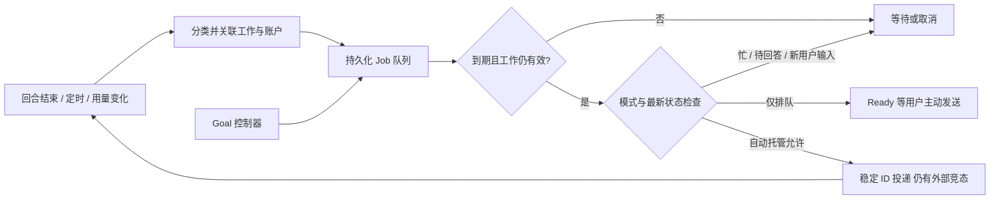

# SubscriptionEvo 可行性与设计研究

研究日期：2026-11-15。以下保留接口研究和设计推演。0.1.2 已按后续授权重载到真实宿主并完成空队列连接检查，输入区浮层、空队列隐藏、插件续跑设置和 slash 目标入口均已实现并完成模拟测试。最终范围、与研究方案的取舍及人工验收见 [实施与验证记录](subscription-evo-implementation.md)。

## 结论

可以把 SubscriptionEvo 做成此 monorepo 的第一个插件。四项需求能够共享一个后端调度器：临时错误重试、定时消息、额度恢复续跑、跨 provider 的目标循环。

用户已明确暂不修改 Paseo。继续研究并进行只读实测后，推荐采用“插件后端自有连接 + 持久化调度器 + 分级投递”的方案。前一版把冷启动和会话额度查询视为需要补宿主接口，结论过于保守：现有 CLI 和 SDK 的 Node 入口已经提供替代路径。

剩余边界是发送竞态：不改宿主，无法对任意现有 provider 保证“检查空闲”和“发送”之间绝无人工操作。自动托管可以显著降低干扰概率，但不能声称零竞态；要求绝不自动干扰的会话只能自动排队、由用户主动发送。实施不再以上游修改为前置条件。

第 1 项已由用户确认：包括 Codex、Claude Code 在内的所有 provider，遇到非额度耗尽的临时错误时退避重试。额度耗尽走独立恢复流程。

用户进一步明确：功能应从 Paseo 输入区域操作；定时与额度恢复后发送的内容仍是 queued message，按消息队列展示，插件主要改变它们的发送时机。下面的“输入与队列交互”是据此修订的产品模型。

| 需求 | 可行性 | 必须明确的边界 |
| --- | --- | --- |
| 非 quota 错误后发送自定义文案，默认 `continue` | 可做 | 仅自动处理可恢复错误；普通工具失败、用户取消、鉴权失败不应一律重发 |
| 固定时间或额度恢复后延迟发送队列消息 | 可做 | 插件持久化队列及自有连接；宿主离线时无法发送；现有接口不能提供原子空闲投递 |
| 未完成工作因 quota 中断后自动继续 | 可做 | 绑定中断的工作、会话和额度窗口；预计刷新时间不等于已恢复 |
| 任意 provider 的类似 `/goal` 能力 | 可做通用目标循环 | 完成判断和精确 token 预算依赖 provider 能力，不能保证与 Codex 原生实现完全一致 |

## 调研基线与证据

首次调研时工作目录为空，未初始化 Git。随后已建立 pnpm monorepo 和 `plugins/subscription-evo`。

- 本机 `paseo --version`：`0.15.4`。
- 主要源码基线：官方 `v0.15.4`，提交 `1c00b365c9e0b74c1580eba33d905d693125ae21`。
- 对照的官方主分支：`cec92d0be66b256794810a27efee1007eb7bf0ed`，package version `0.16.0-beta.2`。
- 当前官网文档、搜索缓存和本地技能内容存在版本差异，实际实现应以目标版本类型及源码为准。例如新文档的 metadata/background 字段不能直接当成 0.15.4 的 hook 字段。
- 已读官方插件、SDK、hooks、schedules 文档及 Codex Goals 官方说明。没有运行付费模型测试，没有触发实际额度耗尽，没有验证手机 UI。
- 第二轮实测：本机 `paseo usage --agent <当前 agent> --refresh --json` 成功返回一份会话用量报告；独立 Node 连接成功完成身份核对、当前 agent 读取和报告读取，宿主报告权限为 `daemon.read`、`workspace.read`。未发送模型消息或修改宿主配置。测试依赖装在 `/tmp/subscriptionevo-research/bridge-probe`，未安装插件。

## 不修改 Paseo 的推荐路径

### 后端自有连接，随插件启动和停止

在 `index.server.ts` 注册阶段读取插件自己的连接配置，然后异步建立本机连接。使用固定版本的 `@getpaseo/client/node` 导出的 `createHostClient()`；它返回低层 DaemonClient，支持 localCredential、会话权限上限及完整用量查询。将版本相关调用封装在 `server/paseo-adapter.ts`，业务代码只调用我们定义的窄接口。

这不是读取运行中对象、猴子补丁或写入 Paseo 内部状态，也不要求常驻独立操作系统服务。连接、timer 和调度器都属于插件进程；禁用/reload 时先停止领取任务，再关闭连接并等待在途操作结算。已经被宿主接收的消息不能保证撤回，应显示其实际状态。

需要明确：`createPaseoClient()` 的高层配置在 0.15.4 不含 localCredential；不能把 Node 入口支持的选项直接编造进高层 API。`createHostClient()` 和它返回的低层方法虽在已发布包中可调用，但不是稳定的高层插件契约，需要固定版本、兼容性测试及遇到未知版本时停止自动投递。

部署边界：

- 第一版只连接插件所在 daemon 的本机 endpoint；远程宿主应在各自机器运行插件，客户端仍通过 Paseo 操作它。
- 首次配置绑定实际 daemon home、endpoint 和 expectedServerId。每次连接核对本机 endpoint 与选定 home 的记录，并在握手后核对 serverId；不匹配不查询任务、不发送。
- 在已有 RPC 上取得宿主身份，与待绑定的本机连接比对。不能依靠工作目录、agent 名称、默认 6767 端口推断宿主。
- Paseo 本地连接凭据只由服务端按需读取，不能写进插件设置、日志、客户端 bundle 或命令行参数；不读取或刷新 Codex/Claude 的订阅 OAuth 凭据。禁止把本地凭据发往远端或自动降级到其他连接地址。
- 自有数据存放在已绑定 home 下的插件专属目录，使用持久化的安装实例标识隔离；不碰 Paseo 的 agent、schedule、receipt 文件。目录 0700、文件 0600，单写者锁、原子落盘及版本校验。

依据：[已发布 Node 入口](https://github.com/getpaseo/paseo/blob/v0.15.4/packages/client/src/node/index.ts)、[官方 CLI 连接方式](https://github.com/getpaseo/paseo/blob/v0.15.4/packages/cli/src/utils/client.ts)、[本地凭据与 endpoint 绑定](https://github.com/getpaseo/paseo/blob/v0.15.4/packages/server/src/server/local-credential.ts)。

### 尽量缩小连接权限

常驻观测连接请求 `sessionPermissions: ["daemon.read", "workspace.read"]`；本次已验证宿主返回的权限恰为这两项。独立发送连接只在有合格任务时使用，按协议需要 `workspace.write`，并且仍做插件自己的 agent 白名单、工作版本、消息来源及预算校验。

不申请 daemon.manage、access.manage、tunnel.manage、workspace.manage、automation.manage。适配器只暴露读取、订阅和投递方法，不暴露任意 RPC、终端、配置修改或权限回答。

权限上限是连接级、操作类别级，不是某个 agent 专属的 capability。插件进程仍是可信、无沙箱代码，持有本地凭据；不能声称这能隔离恶意插件代码。它主要限制误调用的影响范围，依赖最小依赖集、版本固定与代码审查。

依据：[权限声明](https://github.com/getpaseo/paseo/blob/v0.15.4/packages/protocol/src/messages.ts#L147)、[宿主限制连接权限](https://github.com/getpaseo/paseo/blob/v0.15.4/packages/server/src/server/websocket-server.ts#L1790)、[操作权限映射](https://github.com/getpaseo/paseo/blob/v0.15.4/packages/server/src/server/authorization/operation-permissions.ts)。

### 用量读取复用宿主现有实现

首选通过上述连接调用 `listUsageReports({ agentId, forceRefresh: true })`；CLI 可作为独立兼容路径：

```text
paseo usage --home <已绑定 home> --agent <完整 agent ID> --refresh --json
```

CLI 调用使用固定可执行文件和 argv 数组，禁用 shell 拼接，设置超时/输出大小上限，按版本 schema 解析。归一化结果只保留 opaque report ID、sourceId、时间戳、窗口和状态；不记录账户标签等非必要个人信息。

0.15.4 的 report 只有 `account.label`，没有公开 `account.key`；稳定报告 ID 在宿主内由 source 和账户 key 组成，插件把完整 ID 当作不透明字符串。`--agent` 比全局 provider 列表更准确，但能力仍取决于该 usage source 的 session discovery；不支持、返回多个无法区分的候选或账号发生变化时不猜测。

强制刷新会读取新用量，但不等于每次重新发现账户身份。宿主按 sessionKey/provider/model 缓存会话映射；在同一 session 外部切换登录后，不能仅靠同一 report ID 宣称身份仍正确。发现登录/模型变化、会话重开、报告身份变化时暂停并重新绑定；无法观测的外部切换仍是边界，应在托管会话使用期间避免切换其登录。

用量获取只做观测，绝不自动登录、刷新 OAuth、换账户、切换 provider 或购买额外额度。`lastSuccessful` 仅供展示，不能在当前读取失败时授权继续。恢复检查按账户合并、有限频率，不每个 agent 各自高频轮询。

依据：[CLI 用量实现](https://github.com/getpaseo/paseo/blob/v0.15.4/packages/cli/src/commands/usage/index.ts)、[会话映射缓存](https://github.com/getpaseo/paseo/blob/v0.15.4/packages/server/src/server/plugins/usage-sources/index.ts#L129)。

### 投递采用两个明确模式

**自动托管模式**：用户为选定会话启用自动续跑，最好在专用任务会话中使用。启用时给定目标/消息、次数和时间预算、有效期。插件拥有唯一的 dispatcher，但这不是宿主锁，Paseo 原生 UI 和其他客户端仍能发送消息。

每次投递前：

1. 确认连接、身份、观测订阅均健康；重连或事件缺口先全量对账，无法确认就暂停。
2. 确认未归档、未人工取消、无待处理权限/问题、无已知活动回合，工作版本和 quota binding 未变化。
3. 保留短暂稳定窗口，再读取最新 snapshot 和用户消息边界；一旦变化撤销领取并重新评估。稳定窗口降低碰撞概率，不是原子性证明，也不是“用户同意”。
4. 在插件单写者锁下再次确认 job、预算和托管状态，用稳定 messageId 发一次。发送结果 unknown 先核对，绝不换 ID 盲发。
5. 观察到人工输入或接管操作时取消自动任务。接管 UI 必须先持久化暂停并结算在途 dispatch，才能显示“已暂停”；它不能撤回已经被宿主接收的消息，也不能即时拦截其他客户端的输入。

默认不自动修改权限模式、不回答权限请求、不重启会话、不解除归档、不恢复人工暂停。后两项目前只能在发送前检查，因为普通发送路径本身会加载/解除归档，仍有并发边界。

`steer` 不是安全锁：0.15.4 的 `steerOrReplaceActiveTurn()` 在 provider 不支持或拒绝 steering 时可以替换当前回合。双检查、事件订阅和插件内部 mutex 都无法完全消除最终检查之后的竞争。托管模式应如实说明这一剩余风险。

**仅排队模式**：用于正在和人交互的会话，或用户要求绝不由自动化打断的任务。插件自动监测、退避、计算时间并将消息变为 ready，放入插件队列供用户主动发送，不自动改写 composer 草稿。点击发送是用户明确操作，仍显示当前运行/权限状态；后台绝不发送。它提供严格的“不自动干扰”边界，但不等于全自动继续。

已有会话默认不被批量接管；开启托管是明确的产品配置动作，不需要每次 continuation 再确认。使用者可随时改回仅排队。未来若要自动化且严格零竞态，需要掌控所有 provider 输入入口的代理/自定义 provider，或宿主原子 API；目前不能同时无条件承诺两者。

依据：[steer 的替换后备路径](https://github.com/getpaseo/paseo/blob/v0.15.4/packages/server/src/server/agent/agent-manager.ts#L3050)、[发送的解除归档行为](https://github.com/getpaseo/paseo/blob/v0.15.4/packages/server/src/server/agent/agent-prompt.ts#L324)。

### 其他路线的取舍

| 路线 | 判断 |
| --- | --- |
| 仅公共 hook/RPC SDK | 可用于普通交互；没有冷启动事件时仍不适合持久调度 |
| 后端自有 Node 连接 | 推荐，已完成独立只读连接验证；需验证插件实际打包、生命周期和发送行为 |
| CLI 读取额度 | 可用且已实测；作为兼容路径，不通过 CLI 执行自动发送 |
| CLI 自动 send | 0.15.4 无 messageId 参数，重试容易生成新 ID；还有来自环境 PASEO_AGENT_ID 的消息来源语义，不宜作为 dispatcher |
| Heartbeat / schedule run-once | 不是原子安全投递。heartbeat 先检查 active run，之后走 replaceRunning + steer，中间仍可能竞争；重复 cron 也不适合一次性队列 |
| 浏览器/UI 自动输入 | 无持久化投递契约，依赖页面与焦点，会干扰用户，不采用 |
| 直接写 Paseo 内部队列、receipt、数据库 | 绕过状态一致性和权限路径，不采用 |
| 独立 OS 常驻服务 | 可以做，但插件禁用后的停机和授权边界更复杂，第一版不需要 |
| 包装 Codex/Claude/ACP 协议的自定义 provider | 长期可研究，需拥有全部输入与取消入口；各 provider 协议不同，非第一版通用捷径 |

依据：[CLI send](https://github.com/getpaseo/paseo/blob/v0.15.4/packages/cli/src/commands/agent/send.ts)、[heartbeat 执行路径](https://github.com/getpaseo/paseo/blob/v0.15.4/packages/server/src/server/schedule/service.ts#L928)。

### 已确认的基础能力

1. `server.addHook("agent.turn.after", ...)` 能接收 completed / failed / canceled；失败包含 message 和可选 code。`agent.permission.before/after` 可观察待处理权限或问题，`agent.archive.after` 可撤销工作。hooks 是实时、尽力交付，不持久化、不重放，回调可以并发。[Hooks 文档](https://paseo.sh/docs/plugins/hooks)
2. `agent.timeline.refetch(...)` 可以读取历史。事件不携带完整历史；必须按对应 turnId 关联，分页寻找被后续回合挤出尾部的目标回合，不能把最新输出认作原错误回合。[0.15.4 生命周期类型](https://github.com/getpaseo/paseo/blob/v0.15.4/packages/plugin/src/server/lifecycle.ts)
3. `paseo.agents.ref(id).send(text, options)` 能发送新消息；这是开启后续回合，不是回放失败的 HTTP 请求或工具操作。[SDK](https://paseo.sh/docs/sdk/reference)
4. daemon 已有 usage source 机制，0.15.4 包含 Claude、Codex、Copilot、Cursor、Grok、Kimi、MiniMax、OpenCode Go、Z.ai 的 source 目录。这表示存在适配实现，不表示所有账号或启动配置都可读取。[内置插件源码](https://github.com/getpaseo/paseo/tree/v0.15.4/plugins)
5. 用量窗口有可选 `remainingPct`、`usedPct`、`resetsAt`；字段缺失是合法状态。[用量协议](https://github.com/getpaseo/paseo/blob/v0.15.4/packages/protocol/src/messages.ts#L6414)
6. 后端能运行 Node 逻辑，前端能注册设置页、面板、composer pill、slash command、时间线行。适合由后端独立调度，客户端只显示和编辑。[插件参考](https://paseo.sh/docs/plugins/reference)

## 公共插件 API 缺口与后续演进

本节记录高层 API 的缺口。前两项已由上面的自有连接方案绕开；下面的上游建议不是当前实施前置条件。

### 1. 插件冷启动时没有公开的 PaseoApi

0.15.4 的入口 `PluginServerContext` 只暴露注册方法；SDK 位于 hook/RPC 的 `context.paseo`。实现内部确实创建了 SDK，但没有传给入口。只在第一次 RPC/hook 到来后保存它，能支持当次进程内的定时器；重启时如果没有任何事件或客户端交互，就不能保证定时发送能启动。

建议向入口提供生命周期绑定的 `server.paseo`，或提供带 SDK 的启动回调，并给出插件实例专属、跨更新稳定的数据目录。队列应在启动时恢复，而不是依赖用户打开面板。

这些是拟议接口，不是当前已存在的 API。本版将独立 Node 连接设为显式配置和受控依赖，已验证它可以不依赖 hook 初始化；不能默认连接任意本机 daemon。

证据：[入口类型](https://github.com/getpaseo/paseo/blob/v0.15.4/packages/plugin/src/server/contracts.ts)、[运行时入口装配](https://github.com/getpaseo/paseo/blob/v0.15.4/packages/server/src/server/plugins/plugin-process.ts#L275)。主分支入口也尚未提供此能力。

### 2. 插件 SDK 暴露的用量接口不足以准确绑定当前账户

`paseo.providers.listUsage()` 是旧兼容接口。它没有 agentId、reportIds 或 forceRefresh 参数。旧映射将 sourceId 放进 providerId，未保留独立账户 key/report ID，不能把它当成会话 provider ID，也不能用显示名称匹配多账户。0.15.4 映射还没有填每条结果的 fetchedAt，只提供外层时间。

daemon 内部已有 `usage.list_reports`：支持 agentId 对应的会话发现、账户报告、强制刷新；普通缓存为五分钟。公开 `PaseoApi` 尚未封装这个能力，不能把低层 DaemonClient 的方法写成插件现成可用的接口。

未来可把该功能封装成插件高层 API，例如 `paseo.usage.listReports({ agentId, forceRefresh })`。这是 API 草案；当前用已发布 Node 客户端或官方 CLI 访问现有 RPC，不读取 provider OAuth 文件或仿造插件内部 IPC。

证据：[公共 SDK](https://github.com/getpaseo/paseo/blob/v0.15.4/packages/client/src/index.ts)、[用量 registry 与旧接口映射](https://github.com/getpaseo/paseo/blob/v0.15.4/packages/server/src/server/plugins/usage-sources/index.ts#L240)、[已有用量请求处理](https://github.com/getpaseo/paseo/blob/v0.15.4/packages/server/src/server/session/usage/usage-session.ts)。

### 3. 缺少“仅在条件满足时发送”的原子操作

`send` 的 `activeTurnBehavior` 只有 `interrupt` 和 `steer`；默认是 interrupt。普通发送路径还设置 `clearPendingPermissions: true`。先 refresh 再 send 存在竞态：检查后用户可能开始新回合或出现问题；steer 也不是只在空闲时发送。

建议增加宿主原子操作：在同一个 admission 步骤检查 expected turn/revision、agent 空闲、无待处理问题、无用户排队消息、未归档，再接收消息，否则返回 deferred/conflict。不能靠伪造 sourceAgentId 借用 agent 间消息队列；那不是插件的延迟投递接口。

需要时再检查 provider 后台工作。后台 shell 是否阻止续跑应按任务策略决定；数据不可见时不能声称已确认所有后台工作结束。

证据：[发送选项](https://github.com/getpaseo/paseo/blob/v0.15.4/packages/client/src/daemon-client.ts#L462)、[消息接收路径](https://github.com/getpaseo/paseo/blob/v0.15.4/packages/server/src/server/session.ts#L8303)。

## 功能设计

### 临时错误退避

为 provider 定义 ErrorAdapter，归一化成 transient、quota、auth、configuration、context、canceled、unknown。先信结构化错误，再做 provider 特定文本解析；HTTP 429 可能是速率限制，也可能是订阅耗尽，不能单凭状态码分类。普通工具命令失败可能被 agent 自己处理，不是回合级故障。

建议默认策略，均可配置：

- 网络中断、超时、明确的临时服务错误：30 秒起，指数退避，上限 10 分钟，最多 5 次，增加小幅 jitter；有效 Retry-After 作为最早尝试边界。
- quota：直接进入 wait-quota，不消耗临时错误重试次数。
- 鉴权/配置错误、人工取消、等待用户回答：暂停，不发送 `continue`。
- 未知错误：显示原因和手动重试入口；用户可为具体 provider 增加规则。
- 退避次数按工作与故障段累计；不能收到自动消息产生的新 turnId 就清零。成功且有实质进展、或明确的新用户任务才开启新的故障段。
- provider 内部仍在重试/执行时，插件不重复发起重试；在回合终止后判断。

每条自动消息记录触发 turnId、规则版本、尝试次数、预计时间与发送结果。原请求有附件时保留原会话上下文，不重新上传附件或重放工具；如果失败发生在请求入库前，应呈现“原任务是否收到未知”，不盲发 continue。

### 定时消息与额度恢复

队列支持三种触发器：

| 触发器 | 行为 |
| --- | --- |
| at | 用户选定时区的日期时间转换为 UTC dueAt |
| after-recovery | 等待当前绑定订阅的一次恢复事件，然后加固定延迟或随机延迟 |
| retry | 由临时错误或 quota 中断创建，绑定对应工作版本 |

“恢复”分两种证据：

- **预计刷新**：来自 resetsAt、可信错误提示或用户手动设置。时间到只允许做恢复检查或有次数限制的尝试，不能直接显示“已恢复”。
- **观察到可用额度**：相关窗口从耗尽变为可用，且数据新鲜、账户匹配。以观察时间作为 recoveryObservedAt；实际恢复可能早于这个时间，UI 应说明观察精度。

严格的“恢复后 x 分钟”默认采用观察到恢复的语义。只有预计重置时间时，用户可以选择“按预计时间尝试”的降级方式。无用量接口、无可信重置时间时，允许手动输入恢复时间；可选低频、有限探测，但一次有效模型请求可能消耗额度，不能称为无成本查询。

建议细节：

- 对同一 account、model/quota scope 合并查询和恢复事件。恢复周期生成稳定 epoch，防止轮询每次都创建任务。
- 同时存在短周期、周限额或模型限额时，只考虑影响当前模型的约束；所有实际阻塞窗口解除后才放行，不是任一窗口刷新就放行。
- `available` 表示报告可读取，不代表额度剩余大于零；空窗口、unknown、查询失败也不代表可用。
- 有效窗口重置时间齐全时，可计算所有阻塞窗口最晚的预计解除时间；未知窗口必须保留 unknown。
- 随机延迟只抽样一次并持久化。例如 `[2, 7]` 分钟抽到 4 分 12 秒，重启后仍然使用该值。
- 固定时间是最早发送时间；到点仍在运行、待审批或 quota 耗尽时显示延期原因，保留消息。
- “下一次恢复后发送”在当前额度健康时等待下一次耗尽→恢复。另设“当前可用则从现在计时”，避免混淆。
- 会话切换账户、模型或配置后重做绑定，旧恢复事件不能解锁新账户的任务。无法判定账号时暂停自动恢复。
- 默认只发送一次；过期消息提供“补发一次/跳过/过期失效”策略。机器睡眠或 daemon 离线时不可能准时执行。

### 未完成工作在 quota 后续跑

非 goal 会话也可支持：只要已启用自动恢复，且明确是执行中的回合因 quota 失败，就保存该中断工作。在恢复并延迟后发自定义文案，默认 `continue`。

不能把“agent 当前 idle”或“最后一条没有完成字样”当作未完成。对于 provider 把 quota 写成正常回复的情况，适配器需要明确证据；一般自然语言输出中的相关词汇不足以自动触发。

生成的 resume job 绑定 agentId、工作 generation、失败 turnId、账户及 quota epoch。用户取消、替换任务、归档、手动成功继续或目标完成时取消旧 job；只有修改文案等不改变任务含义的操作可保留。恢复前再检查工作仍有效，避免旧的 continue 跑进新任务。

同一工作同时出现 quota resume 和 goal continuation 时，合并为一次调度。用户明确排队的消息保留原文并优先处理，不与自动 continue 合并或丢弃。

### 跨 provider 的 Goal

目标保存为会话范围的持久化记录，包含 objective、acceptance criteria、constraints、status、progress、预算、连续无进展次数和工作 generation。

建议状态：active、waiting-retry、waiting-quota、waiting-user、paused、blocked、completed、budget-limited。clear 删除当前目标关联但保留审计记录；cancel/pause 撤销后续自动消息。额度等待独立于 blocked，不占用“无进展”计数。

每轮结束后：核对目标与证据 → 完成则结束 → 等待用户则停 → quota 则等待 → 没完成且有进展、预算允许则进入队列。每次自动消息带当前目标与尚未完成的验收项，不只重复裸 `continue`。

能力分层：

1. 支持工具注入的 provider：通过 `agent.open.before` 注入 `subscription_evo_goal_status`、`subscription_evo_goal_report` 等工具。报告包含状态、进展和证据引用；goal 控制器核验后决定状态转移。用户决定创建、暂停、恢复、清除；模型不能自行解除用户暂停或提高预算。
2. 只支持普通文本的 provider：在提示中约定结构化结尾，附当前 goal/turn nonce，严格解析与当前回合关联。不合规或无法确认时停为需要检查；不能用无限追问补救。
3. provider 无可靠回合结束信号或消息发送能力时，不能承诺自动循环；显示不支持，而不是伪装为完整兼容。

token usage 可见时累计并在下一回合前阻止超预算；仍可能有单回合超出。不可见时使用自动回合数、活跃运行时间及无进展上限，明确“token 预算不可测”。默认不增加额外付费评审模型来判断完成。

建议首版统一使用 `/evo-goal <目标>`、`/evo-goal status|pause|resume|clear`。Paseo 的插件 slash command 优先于 provider command，直接注册 `/goal` 会遮蔽 Codex 原生命令。后续如提供 `/goal` 别名，必须显式处理 Codex 的委托或所有权切换。

Codex 在 Paseo 0.15.4 已有原生 goal 支持，会调用 `thread/goal/set`，本身能启动后续回合。一个会话只能有一个自动续跑控制器。不能同时让原生 goal 和插件 goal 各自发送 continuation；插件模式需要明确关闭/暂停原生目标，无法确认时阻止双重启用。

依据：[Codex 原生接入](https://github.com/getpaseo/paseo/blob/v0.15.4/packages/server/src/server/agent/providers/codex-app-server-agent.ts#L5188)、[slash command 优先级](https://github.com/getpaseo/paseo/blob/v0.15.4/public-docs/plugins/reference.md#slash-commands)。官方 Goals 的可借鉴语义是持久目标、空闲边界继续、证据驱动完成与暂停/预算控制，而不是无限续写。[OpenAI Goals 说明](https://developers.openai.com/cookbook/examples/codex/using_goals_in_codex)

## 调度与存储



所有触发器都只写队列；只有 dispatcher 能发消息。每个 agent 串行领取任务，同一账户的 quota 检查与恢复节奏合并。不要在 hook 中等待几分钟，hook 只完成短事务并返回。

建议数据实体：

- Policy：host/workspace/agent 范围配置，优先级 agent > workspace > host。
- Job：id、hostId、installationId、agentId、workGeneration、kind、payload、trigger、sampledDelay、dueAt、expiresAt、state、messageId、attempt、lease、lastError。
- QuotaBinding：会话/账户/source/model scope、阻塞窗口、resetAt、observedAt、confidence、epoch。
- Goal：objective、验收条件、控制状态、预算与进展。
- Event：接收、分类、延期、取消、发送、状态报告等审计事实。

队列状态：waiting-trigger → scheduled → ready → dispatching → accepted；另有 deferred、canceled、expired、failed、unknown。accepted 只表示宿主已接收，不代表任务成功，回合结果另行记录。

小规模首版可用单写者、原子替换的 JSON 状态及备份；任务量增大后再评估 SQLite，先核对宿主 Node 与插件打包能力。动态队列与用户设置分开，不能放在安装源码目录，也不写凭据。使用已显式绑定 home 下的插件专属目录和安装实例标识，不硬编码 `~/.paseo`，不依赖新增数据目录接口。

重启恢复：读版本化存储 → 恢复 lease → 核对 agent/工作/用量 → 处理发送结果未知的任务 → 重新调度到期项。重启不会重新抽样或给到期任务统一再加延迟；再次确认真实恢复后才产生新的 quota epoch。

发送去重：每个逻辑投递生成稳定 messageId，传入 `send`。0.15.4 已有持久化 MessageReceipts，已完成的同 ID、同请求不会重复发送；未确认的 pending receipt 会返回 `agent_request_outcome_unknown`。必须将它标记 unknown 并核对时间线，不能换 ID 盲重发，也不能承诺 provider 副作用 exactly-once。

证据：[MessageReceipts](https://github.com/getpaseo/paseo/blob/v0.15.4/packages/server/src/server/message-receipts/index.ts)。

Paseo schedules 创建新 agent，heartbeats 是 cron 重复提示，均不直接提供“账户恢复事件 + 随机延迟 + 一次性任务 + 可取消”的完整语义，所以应由插件拥有此队列。[Schedules 文档](https://paseo.sh/docs/schedules)

## 界面与 monorepo 布局建议

客户端使用 React Native 组件、Paseo theme token 和 compact 布局，支持桌面和移动端。

### 输入与队列交互

**消息是主体，发送条件是消息的属性。** 用户不是在创建一条另存正文的“定时任务”。用户把消息加入队列，选择它何时可以发送；改时间、改恢复延迟或暂停时更新同一条消息。后台 Job 是内部调度记录，不在 UI 中与消息形成两个可独立发送的副本。

四项功能分为两个层级：

| 操作 | 作用范围 | 输入区域的入口 |
| --- | --- | --- |
| 临时错误自动重试、默认 continue 文案 | 当前会话策略 | Evo 按钮中的自动重试开关及设置 |
| 指定时间发送、额度恢复后延迟发送 | 当前这条 queued message | 消息入队时选发送条件；入队后可编辑 |
| quota 后自动恢复 | 当前会话策略，发生中断时产生一条队列消息 | Evo 按钮中的额度恢复选项 |
| Goal 创建、状态、暂停与恢复 | 当前会话目标 | Evo 按钮中的 Goal，或 `/evo-goal` |

每条人工消息入队时把发送条件保存为自己的快照。之后修改会话默认延迟不回写所有历史队列项；批量修改需要明确操作。自动生成的 continue 也作为队列消息出现，标注“自动恢复/重试”，可取消，不隐藏在 timer 中。用户已经排队的消息能承担继续工作时，不再额外发送一条机械的 continue。

### 当前版本能插入到哪里

0.15.4 能注册 `addComposerPill`，位置在输入区域 Tasks/Subagents 附近，支持 menu/popover 和打开 agent panel；能注册 `addSlashCommand`，在主输入框获得命令补全并执行客户端逻辑。

建议只常驻一个紧凑按钮，例如 `Evo · 队列 3`。点击弹出当前会话的消息队列、发送条件编辑器和自动重试/Goal 操作；长列表可展开为 agent panel。全局页面只是多会话总览，不要求用户离开会话去配置每条消息。

0.15.4 没有公开的 composer draft 读写、提交拦截、queued message 修改或 queue renderer 插槽。不能承诺“在原生输入框写完普通消息，点一个定时开关，再按原生发送键就自动被插件接管”。当前按钮弹层需要插件自己的消息输入框；它不能偷偷读取或清空原生草稿。

已检查的 0.16.0-beta.2 主分支增加了 `addComposerItem`、`useComposer`、`composers`，可读写 prompt 和自己的附件，但仍没有原生 queue API 或发送拦截。它不是本机已安装能力，也不能作为绕过原生发送时序的依据。

证据：[0.15.4 客户端插件接口](https://github.com/getpaseo/paseo/blob/v0.15.4/packages/plugin/src/client/contracts.ts#L174)、[composer pill 按钮行为](https://github.com/getpaseo/paseo/blob/v0.15.4/packages/plugin/src/client/buttons.ts)、[已检查主分支 composer 类型](https://github.com/getpaseo/paseo/blob/cec92d0be66b256794810a27efee1007eb7bf0ed/packages/plugin/src/client/composer.tsx)。

### 两条可落地的输入路径

**按钮路径**：点 `Evo` → 在弹层写消息 → 选择“空闲时 / 指定时间 / 额度恢复后” → 点击“加入队列”。其中指定时间显示日期、时区；额度恢复后支持固定 x 分钟或随机 x–y 分钟。弹层正文在服务器确认持久入队后才清空；请求失败保留内容并允许重试。第一次提交携带 clientMutationId，连接重试不会重复入队。

**主输入框路径**：使用插件 slash command，命令参数同时包含发送条件和正文，例如以下拟议语法：

```text
/evo-send at 2026-11-16T09:30+08:00 -- 检查昨晚的 CI，然后修复失败项
/evo-send after-quota 3m -- 继续完成尚未结束的工作
/evo-send after-quota 2-5m -- 运行完整测试并整理结果
/evo-queue
/evo-retry on
/evo-goal 修复问题，并以测试通过作为完成条件
```

`--` 后是待发送正文；调度指令不会发给模型。只解析明确语法，保留正文内部换行；时间不明确或非法时保留为待修正输入，不猜测日期并立即发送。该方式在 agent 运行时仍可操作，因为客户端先处理 plugin slash command，之后才走普通消息的 queued/submitted 分支。

必须处理两项宿主限制：

- 有附件时 Paseo 不执行 plugin slash command，输入可能继续走普通消息发送。因此首版 slash 路径只支持无附件文本，补全描述中明确说明；附件延迟发送必须有插件自己的完整保存/上传路径后再开放，不能承诺接管原生附件。
- Paseo 在执行 slash callback 前已经清空主输入框，不等待 RPC 成功。插件须立即保留参数供失败恢复，在队列弹层显示“未入队，重试/复制正文”，成功前不显示“已排队”。插件只能保护收到 callback 之后的内容，无法保证宿主清空输入到 callback 运行之间的崩溃窗口；较长内容推荐按钮弹层路径。

证据：[slash 命令先于普通发送处理](https://github.com/getpaseo/paseo/blob/v0.15.4/packages/app/src/composer/index.tsx#L1715)、[提前清空输入](https://github.com/getpaseo/paseo/blob/v0.15.4/packages/app/src/composer/index.tsx#L1457)、[附件与命令解析](https://github.com/getpaseo/paseo/blob/v0.15.4/packages/app/src/plugins/client-slash-commands/model.ts)。

### 原生队列与插件队列的真实边界

原生 `QueuedComposerMessage` 只有 id/text/attachments，没有 notBefore、quota gate 或 hold 状态。它保存在客户端 `session-store.queuedMessages`，由客户端 runtime 在 agent 停止运行时取第一条发送。daemon 的 agent 间消息 batching 是另一套队列，不能混同。

当前插件 SDK 不能读取、编辑或阻止该原生队列。不能先放入原生 queue 再用插件“晚一点发送”：原生 runtime 可能先发出去。也不能通过私有 store import、DOM 操作或改写内部函数接管它。

因此当前实现是 **SubscriptionEvo 扩展消息队列**：展示和操作遵循 queued message 的习惯，但消息由插件后端持有，并在满足条件时通过正常消息接口投递。入口靠近输入框，完整列表在 pill popover/agent panel；不谎称已经插进原生 queued rows 的位置，也不将两份列表伪装成已经统一。

这也带来一个新的并发边界：另一客户端的原生 queued 消息可能尚未发到 daemon，插件无法看到。无法保证“原生 queue 先发”或两套队列的全局 FIFO。自动托管会话建议把需要排队的消息统一通过 Evo 输入；原生输入仍可人工使用，但观察到人工消息后重新评估/暂停自动调度。不能把“未观察到原生队列”显示成“原生队列为空”。

证据：[原生 queued message 结构与编辑](https://github.com/getpaseo/paseo/blob/v0.15.4/packages/app/src/composer/actions.ts#L23)、[客户端队列状态](https://github.com/getpaseo/paseo/blob/v0.15.4/packages/app/src/stores/session-store.ts#L446)、[原生自动出队](https://github.com/getpaseo/paseo/blob/v0.15.4/packages/app/src/runtime/host-runtime.ts#L2563)、[原生队列 UI](https://github.com/getpaseo/paseo/blob/v0.15.4/packages/app/src/composer/index.tsx#L383)。

### 队列如何展示与操作

列表首先显示消息正文摘要，下面一行解释当前不能发送的原因。示意如下，这是插件弹层/面板内的布局，不是已经改造的原生队列：

```text
待发送 · 3                          全部暂停

1  检查昨晚的 CI，然后修复失败项
   11 月 16 日 09:30 · GMT+8
   编辑正文  修改时间  取消

2  运行完整测试并整理结果
   额度恢复后 2–5 分钟 · 等待恢复
   编辑正文  修改条件  取消

3  continue
   自动恢复 · 已观察到额度恢复 · 剩余 03:42
   编辑正文  修改条件  取消
```

消息正文和附件快照是唯一 payload。按钮包括编辑、修改发送条件、暂停/恢复、调整顺序、取消；发送中或结果未知时锁定修改，先完成投递核对。若提供“尽快发送”，它只是解除时间等待，仍等待空闲与权限问题解决，不默认中断当前回合或忽略 quota。默认不展示危险的强制发送按钮。

未发送的消息不伪装为已发送的聊天气泡。服务器确认接收后显示“已交给 Paseo”；核对正常用户消息记录后结束等待展示，历史详情保留调度信息。时间线可追加少量状态事件作为辅助，但不能只显示“已安排任务”而隐藏实际正文。

队列状态建议为：queued（附 waitReason）、dispatching、accepted、sent、unknown、canceled。queued 的 waitReason 可以是 time、quota、recovery-delay、agent-busy、previous-message、permission、paused、offline；预计刷新与已观察到恢复必须区分。

同一条消息更新发送条件时不更换 UI message id；编辑正文增加 payloadRevision。真正投递前冻结正文和 delivery messageId，同一冻结投递使用稳定 ID 重试；不要用同一投递 ID 发送不同正文，否则宿主 receipt 会冲突。随机延迟按恢复周期只抽取一次并保留。

### 顺序与两个层级的暂停

插件内的人工消息默认按显式队列顺序发送，队首条件未满足时后续显示“等待前一条”，不暗中越过。用户可调整顺序或明确要求某条先处理；多个独立定时任务若以后支持按到期时间选择，应作为单独、明确的顺序策略。

自动 continue 不阻塞人工消息，不抢在人工消息之前发送；一个工作版本最多一条有效自动 continuation。人工消息使工作改变时，撤销过时的自动 continue；人工编写的定时消息本身保留，必要时暂停并展示原因，不能因为出现新 turn 就静默删除。

每条消息可暂停，整个会话也可暂停自动发送；暂停会话不会丢失已经排队的内容。Goal 的暂停只停止它生成的新续跑消息并取消它尚未投递的自动消息，不自动删除用户另外排好的消息。

跨设备以 daemon 队列为权威。编辑/排序/取消使用 revision 条件更新，过期客户端收到冲突后刷新；断线界面可显示最后一次快照，但不宣称已同步。断线时提交的新内容保持“未入队”草稿，不伪装为服务器已接受的 queue。

补充验收：四种操作可在输入区域找到；运行中可执行无附件 slash 入队；参数错误/断线不丢失插件收到的内容；重复提交幂等；改时间不复制正文；随机延迟重启不重抽；队列按正文展示；原生队列并存的限制可见；多端修改冲突不会覆盖；插件禁用时保持待发送记录且停止新投递。

### 项目布局

建议采用 pnpm workspace，第一版保持插件独立，后续第二个插件出现后再抽共享包：

```text
docs/subscription-evo-research.md
plugins/subscription-evo/
  paseo-plugin.json
  package.json
  OVERVIEW.md
  index.client.tsx
  index.server.ts
  client/                 # 设置、队列、goal、时间线
  server/                 # store、dispatcher、adapters、goal-controller
  shared/                 # Zod contracts、状态类型、纯策略
```

发布名称 SubscriptionEvo，ID 建议 `subscription-evo`。第一版针对 0.15.4 固定 SDK/协议版本并进行验收；其他版本通过适配器兼容矩阵逐步放开，不能笼统写“所有 >=0.14 都支持”。monorepo 内跨包代码需要独立打包并验证安装，不依赖插件目录外的随意相对导入。

## 实施顺序与验收

1. **连接与只读验证**：已完成 0.15.4 的独立连接、只读权限和会话用量读取；下一步验证插件实际打包、冷启动与 disable 清理，确认身份与安装实例绑定。
2. **核心 MVP**：版本化存储、唯一 dispatcher、固定时间队列、可恢复错误分类、受限退避、取消和审计。先用 fake provider/clock 验证，不烧真实订阅。
3. **额度恢复**：优先 Codex、Claude；验证多窗口、多账户、未知/过期数据；其他 provider 通过同一能力接口接入。即使没有用量读取，固定定时和人工预计时间仍可用。
4. **通用 Goal**：工具报告与文本降级、证据完成、无进展停止、预算、与原生 goal 互斥。
5. **真实宿主与 UI**：先用专用测试会话验证安装、reload、daemon 重启、无人连接时到点发送及人工操作碰撞；桌面与 compact、明暗主题交互。只读探针不证明自动发送已安全。

必须覆盖的行为测试：

| 场景 | 预期 |
| --- | --- |
| 网络失败、重复 hook、乱序通知 | 同一失败段只创建一个重试链，次数不被新 turn 清零 |
| quota 与瞬时 429 | 走不同分支，不因任意 429 等待订阅重置 |
| 短窗口恢复但周限额仍满 | 不发送 |
| 用量为 available 但 remaining=0，或读取失败 | 不误判已恢复 |
| 多账户或 OpenCode/Pi 使用 Codex/Claude 订阅 | 绑定实际账户与模型 scope，不按 provider 名猜测 |
| reset 到期但快照过期 | 检查后再行动，展示预计而非确认 |
| 随机延迟期间重启 | 原抽样值和 dueAt 保留 |
| 无客户端、无新 hook 的冷启动 | 队列自动恢复并执行符合条件的任务 |
| 到点前观测到用户开始工作或出现审批 | 撤销发送并延期；另测最后检查后的竞态，不能把未遇到竞争当成原子性证明 |
| 仅排队模式 | 所有定时、错误、quota、goal 触发均不自动发送 |
| 错误 serverId、endpoint、未知协议版本 | 停止调度，不尝试其他地址或默认宿主 |
| 插件断线/重连/漏事件 | 对账完成前不自动发送；无法关联原任务则等待用户 |
| 连接权限 | 观测连接仅含两项只读权限；发送连接不含管理权限，适配器无任意 RPC 出口 |
| 用户取消、替换任务、归档 | 撤销绑定旧工作版本的自动消息 |
| goal 与 quota 同时触发 | 一次有效 continuation，不重复 |
| 发出后、记录成功前崩溃 | 稳定 messageId；unknown 走核对，不盲重发 |
| provider 不报告 token usage | 不声称精确 token 限制；回合/时间限制有效 |
| 无进展、错误的 completed 报告 | 停止或等待证据，预算耗尽不标完成 |
| Codex 原生 goal 已活动 | 不启动第二个续跑循环 |
| reload/disable | timer 和订阅清理；禁用期间不发送，重新启用按过期策略恢复 |

研究阶段已完成不改宿主的连接与额度路径只读验证，明确了投递方案及剩余竞态。随后以离线编译和模拟测试为主，取得用户授权后完成插件安装、重载及只读状态核对；开发版代码与最终验收状态以 [实施记录](subscription-evo-implementation.md) 为准。真实模型发送、重启续跑及各 provider 仍未验收。
